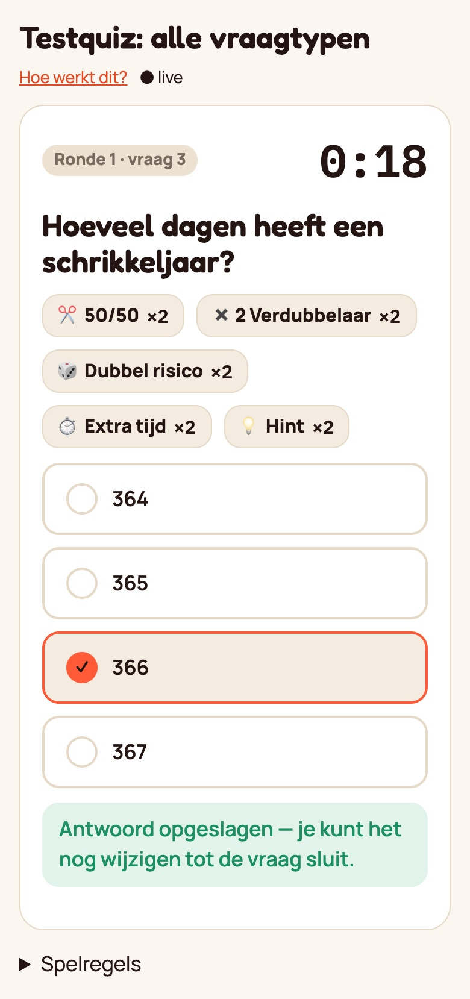
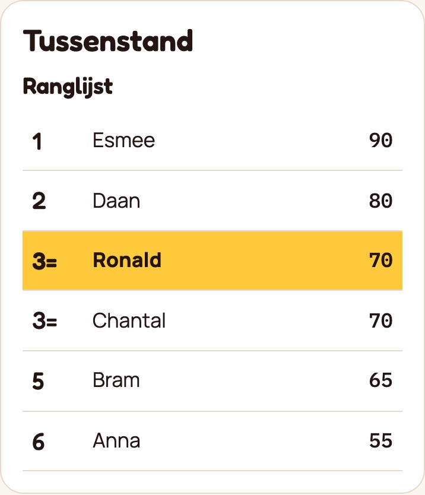

# PuntQuiz

**Realtime pubquiz waarbij elke speler op de eigen telefoon antwoordt, ook in een team.**
*"Elke speler telt, ook in een team."*

Een hobbyproject van Ronald Punt (Puntuale). Draait live op <https://puntquiz.puntuale.nl>. Voorlopig is het project geheel Nederlands: de app, de documentatie en de afspraken. Meertaligheid en eigen styling staan op de [roadmap](#roadmap).

<p>
  
  
  
  
</p>

## Waarom

De meeste pubquiz-apps geven één telefoon aan een heel team. Bij PuntQuiz logt iedereen in en antwoordt voor zichzelf. In teammodus is het teamantwoord de meerderheid van de stemmen van de spelers die hebben geantwoord, en de teamscore is een optelling over de individuele deelnames. Een quizmaster bedient de quiz vanaf een presentatorscherm; spelers doen mee met een code of QR-code.

## Functies

- **Quiz bouwen:** rondes en vragen, een herbruikbare vragenbank (import en export als CSV, XLSX en JSON), categorieën, hints en toelichtingen.
- **Vraagtypen:** meerkeuze, waar/onwaar, meerdere antwoorden, open vragen (exacte match, anders anonieme peer-review met correctie door de quizmaster) en muziekvragen (artiest, titel en jaar scoren los).
- **Media:** afbeeldingen, geüploade audio en YouTube-fragmenten; beeldrondes die nog 1 tot 3 rondes lang beantwoord kunnen worden.
- **Spelvormen:** individueel of in een team; onthullen per ronde of per vraag; tussenstand halverwege en eindstand; gelijke scores delen een plek.
- **Power-ups:** 50/50, verdubbelaar, dubbel risico, extra tijd en hint (bij teams gezamenlijk).
- **Server bepaalt alles:** timers en scores staan op de server; de klok op je telefoon is alleen weergave. Antwoorden worden offline bewaard en binnen 60 seconden alsnog verstuurd.
- **Afdrukbare antwoordformulieren** en antwoordsleutel, voor quizzen met papier naast de telefoon.
- **E-mail (opt-in):** welkomstmail, rondeuitslagen en eindstand in huisstijl.
- **Accounts:** gast, of Authentik (OIDC) met optioneel sociale logins en MFA. Meespelen mag iedereen; quizzen maken en presenteren vraagt toestemming van de beheerder (`HOST_APPROVAL`, zie `docker-compose.yml`).
- **PWA:** te installeren, met een offlinepagina. Live gegevens worden nooit gecachet.

## Techniek

| Onderdeel | Technologie |
| --- | --- |
| `apps/web` | Nuxt 4 (SPA), Vue 3, TypeScript |
| `apps/api` | NestJS 11, Prisma 6, PostgreSQL, Redis, Socket.IO (sockets zeggen alleen "haal opnieuw op"; acties lopen via REST) |
| `packages/contracts` | Gedeelde TypeScript-types voor web en api |
| `infra/authentik` | Authentik-blueprint (OIDC, flows, huisstijl) en het Nederlandse herstelmail-sjabloon |
| Draaiomgeving | Eén Docker Compose-stack achter Traefik |

De product- en techniekspecificatie is `PuntQuiz - Consolidated Product Reference.md`: doel, rollen, spelregels, scores, architectuur en, in Appendix C, wat er gebouwd is en wat niet.

## Lokaal draaien

Je hebt Docker (met Compose) nodig, en Node 22 voor de testscripts.

```bash
docker compose up -d --build
```

Open daarna <http://localhost:8088>. Lokaal kun je meedoen als gast of met een lokaal wachtwoordaccount; inloggen via Authentik is op <http://auth.localhost:8088>. Het eerste account dat je aanmaakt wordt quizmaster/beheerder.

Instellingen (SMTP voor mail, sleutels voor sociale logins, geheimen) komen uit een `.env`-bestand dat niet in de repo staat. `docker-compose.yml` noemt de variabelen; zonder werkt alles nog steeds, alleen mail en sociale logins staan dan uit.

```bash
npm ci                          # eenmalig, voor tests en linting
npm test                        # unittests (api)
node tests/e2e.mjs              # end-to-endtest van de API tegen de draaiende stack
node tests/sw.test.mjs          # regels van de service worker
npm run lint
npm run typecheck
npm run design                  # Impeccable-ontwerpcontrole op de webbronnen
```

Draai de e2e-test alleen tegen een lokale stack: tegen een echte server laat hij testgegevens achter.

## Mappen

```
apps/api            NestJS-API, live-engine, Prisma-schema en migraties
apps/web            Nuxt-app (pagina's, componenten, composables, publieke bestanden)
packages/contracts  gedeelde types
infra/authentik     Authentik-blueprint en mailsjabloon
tests               e2e, service worker-test, testbestanden
scripts             deploy-script
assets              favicon-set, avatars, bronnen van de landingspagina
```

## Uitrollen

`scripts/deploy.sh` synchroniseert het project naar een server en draait daar `docker compose up`. Serveradres, SSH-sleutel en map komen uit `scripts/deploy.local.env` (niet in de repo; kopieer `scripts/deploy.local.env.example`). De productiegeheimen staan alleen in de `.env` op die server.

## Status

Een werkend hobbyproject, geen product met ondersteuning. Wat nog niet gebouwd is staat eerlijk in Appendix C van de specificatie.

## Roadmap

Geen beloftes of planning, wel de richting:

- **Meertaligheid:** de app, de mails en de teksten zijn nu alleen Nederlands. Later meerdere talen, met de taal per speler of per quiz.
- **Eigen styling:** nu is er één huisstijl (licht en donker). Later eigen thema's, bijvoorbeeld per quiz of organisatie, met eigen kleuren en logo.
- **Nog niet gebouwd:** zelf je account exporteren en verwijderen, inloggen met Apple, pushmeldingen, een offline app-schil.

## Meedoen

Issues en pull requests zijn welkom, in het Nederlands. Lees eerst [CONTRIBUTING.md](CONTRIBUTING.md).

## Licentie

[MIT](LICENSE) © 2026 Ronald Punt (Puntuale).
