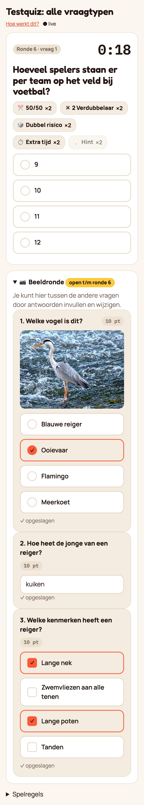
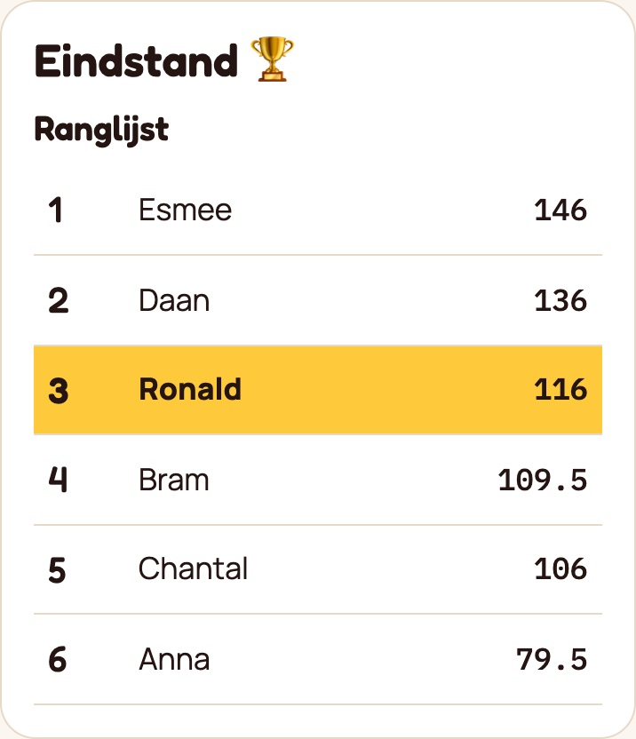

# PuntQuiz

**Real-time pub quiz where every player answers on their own phone, also in a team.**
*"Elke speler telt, ook in een team."*

A hobby project by Ronald Punt (Puntuale). It runs live at <https://puntquiz.puntuale.nl>. The interface and texts are in Dutch; the code and docs are in English.

<p>
  
  
  
  
</p>

## Why

Most pub-quiz apps give one phone to a whole team. PuntQuiz lets everyone log in and answer for themselves. In team mode the team's answer is the majority vote of the players who answered, and the team score is an aggregate over individual participations. A quizmaster runs the quiz from a presenter screen; players join with a code or QR.

## Features

- **Quiz building:** rounds and questions, reusable question bank (CSV, XLSX and JSON import/export), categories, hints and explanations.
- **Question types:** multiple choice, true/false, multiple answers, open text (exact match, otherwise anonymous peer review with quizmaster override), music questions (artist, title, year scored separately).
- **Media:** images, uploaded audio and YouTube clips; picture rounds that stay answerable during the next 1 to 3 rounds.
- **Play modes:** individual or team; reveal per round or per question; standings halfway and at the end; ties share a rank.
- **Power-ups:** 50/50, double, double risk, extra time and hint (pooled per team in team mode).
- **Server-authoritative:** timers and scoring live on the server; the client timer is display-only. Answers are buffered offline and re-sent within a 60 second grace period.
- **Printable answer forms and answer key**, for quizzes with paper as well as phones.
- **E-mail (opt-in):** welcome mail, round results and final standings in house style.
- **Accounts:** guests, or Authentik (OIDC) with optional social logins and MFA.
- **PWA:** installable, with an offline page. Live data is never cached.

## Stack

| Part | Tech |
| --- | --- |
| `apps/web` | Nuxt 4 (SPA), Vue 3, TypeScript |
| `apps/api` | NestJS 11, Prisma 6, PostgreSQL, Redis, Socket.IO (sockets only say "refetch"; actions go through REST) |
| `packages/contracts` | Shared TypeScript types between web and api |
| `infra/authentik` | Authentik blueprint (OIDC provider, flows, branding) and the Dutch recovery mail template |
| Runtime | One Docker Compose stack behind Traefik |

The product and technical spec is `PuntQuiz - Consolidated Product Reference.md`: mission, roles, mechanics, scoring, architecture and, in Appendix C, what is built and what is not.

## Run it locally

You need Docker (with Compose) and Node 22 for the test scripts.

```bash
docker compose up -d --build
```

Then open <http://localhost:8088>. Locally you can play as a guest or with a local password account; sign-in through Authentik is at <http://auth.localhost:8088>. The first account you create becomes the quizmaster/admin.

Settings (SMTP for mail, social login keys, secrets) come from a `.env` file that is not in the repo. `docker-compose.yml` lists the variable names; without them everything still works, only mail and social login are off.

```bash
npm ci                          # once, for tests and linting
npm test                        # unit tests (api)
node tests/e2e.mjs              # API end-to-end test against the running stack
node tests/sw.test.mjs          # service worker rules
npm run lint
npm run typecheck
npm run design                  # Impeccable design checks on the web sources
```

Run the e2e test against a local stack only: against a real server it leaves test data behind.

## Project layout

```
apps/api            NestJS API, live engine, Prisma schema and migrations
apps/web            Nuxt app (pages, components, composables, public assets)
packages/contracts  shared types
infra/authentik     Authentik blueprint and mail template
tests               e2e, service worker test, fixtures
scripts             deploy script
assets              favicon set, avatars, landing artwork sources
```

## Deploy

`scripts/deploy.sh` rsyncs the project to a server and runs `docker compose up`. The server address, SSH key and directory are read from `scripts/deploy.local.env` (not in the repo; copy `scripts/deploy.local.env.example`). Production secrets live only in that server's `.env`.

## Status

This is a working hobby project, not a product with a roadmap or support. Not built yet: account self-service export and delete, Sign in with Apple, push notifications, offline app shell, and more; see Appendix C of the reference for the honest list.

## Contributing

Issues and pull requests are welcome, in English or Dutch. Read [CONTRIBUTING.md](CONTRIBUTING.md) first.

## License

[MIT](LICENSE) © 2026 Ronald Punt (Puntuale).
